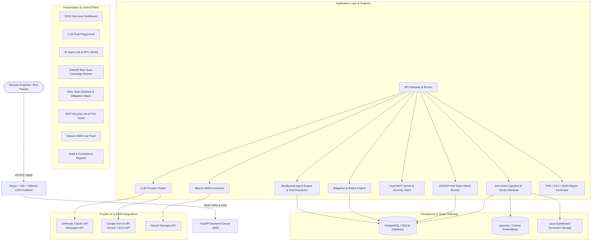

# System Architecture & Technical Specifications
## AI SECURITY FASTER – Enterprise Operations Center

### 1. High-Level Architecture Diagram



---

### 2. Directory Layout
```text
ai-security-faster/
├── backend/
│   ├── app/
│   │   ├── api/                 # FastAPI routes (dashboard, llm, agent, redteam, blueteam, mcp, wazuh, reports)
│   │   ├── core/                # Configuration, logging, security tokens
│   │   ├── database/            # SQLAlchemy session, engine, dynamic sqlite/postgres
│   │   ├── models/              # SQLAlchemy declarative models
│   │   ├── schemas/             # Pydantic validation schemas
│   │   ├── llm/                 # Claude & Gemini providers, router, streaming
│   │   ├── rag/                 # Parsing, chunking, embeddings, similarity search
│   │   ├── agent/               # Sandboxed Agent, 4 tools, human approval gate
│   │   ├── redteam/             # OWASP 2026 test suites (LLM01-10, ASI01-06)
│   │   ├── blueteam/            # Guardrails, input/output scanners, retesting
│   │   ├── mcp/                 # Local MCP server, client, security PoC harness
│   │   ├── wazuh/               # Wazuh API client & alert aggregator
│   │   └── reporting/           # PDF, CSV, JSON export engines
│   ├── requirements.txt
│   ├── run_backend.py
│   └── seed_data.py
├── frontend/
│   ├── src/
│   │   ├── components/          # Reusable SOC components, charts, modals
│   │   ├── pages/               # 12 functional page views
│   │   ├── services/            # Axios / Fetch API clients for backend
│   │   ├── types/               # TypeScript interfaces matching backend schemas
│   │   ├── App.tsx
│   │   └── main.tsx
│   ├── package.json
│   ├── tailwind.config.js
│   ├── vite.config.ts
├── docker-compose.yml
├── .env.example
├── prd.md
├── rules.md
├── tasks.md
├── design.md
├── system_architecture.md
├── memory.md
└── research.md
```

---

### 3. Data Flow & Security Models

#### 3.1 LLM Request & Routing
1. Client requests a completion via `/api/llm/chat` with model choice (`claude` or `gemini`).
2. `llm_router` inspects provider, loads system prompt and optional RAG context.
3. If blue team mitigations are active:
   - Input is scanned by `InputGuardrail`.
   - If prompt injection or secret payload is detected, blocked with warning.
4. Payload forwarded to official Anthropic SDK (`anthropic.AsyncAnthropic`) or Google Gen AI SDK (`google.genai`).
5. Output streamed or returned, inspected by `OutputScanner` (PII/Secret redactor), metrics (latency, tokens) logged to database.

#### 3.2 Red Team Campaign Execution
1. Client launches campaign targeting `claude`, `gemini`, or `both`.
2. Attack Runner iterates through OWASP risk categories (`LLM01`-`LLM10`, `ASI01`-`ASI06`).
3. For each test case:
   - Formulates adversarial prompt.
   - Executes against target model.
   - Heuristically and semantically evaluates response against expected vulnerability signatures (e.g. system prompt leakage, canary disclosure, SSRF confirmation).
   - Generates Pass/Fail and CVSS score.
   - Commits `TestExecution` and `Vulnerability` record.
4. Broadcasts live progress to frontend via SSE / polling.

#### 3.3 Blue Team Mitigation & Retest
1. User activates a defense (e.g., "PII Redaction", "Prompt Injection Firewall", "Tool Whitelist").
2. System triggers a verified retest: runs identical attack vector with defense enabled.
3. If response is sanitized or blocked, updates mitigation record with `verified = True`, calculates before vs after risk percentage reduction.
